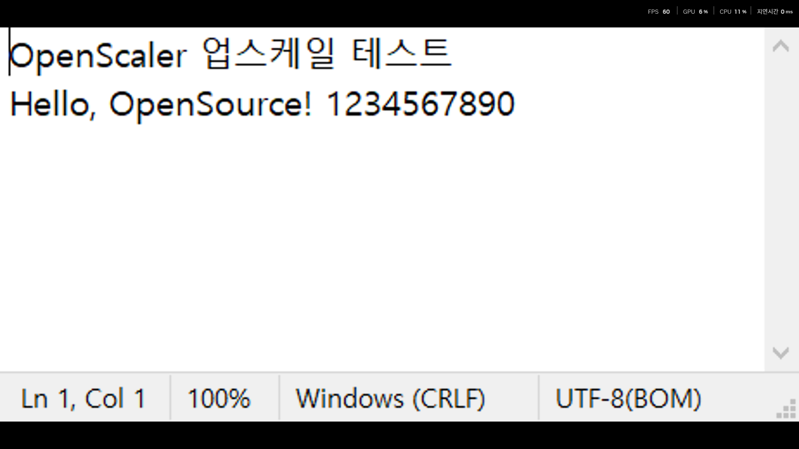

# OpenScaler

**창 모드 게임을 실시간으로 캡처해 전체화면으로 업스케일하는 오픈소스 Windows 프로그램**

상용 프로그램 [Lossless Scaling](https://store.steampowered.com/app/993090/Lossless_Scaling/)의 핵심 기능인 "게임 화면 업스케일링"을 직접 구현해 보는 오픈소스소프트웨어 텀 프로젝트입니다.



> 위 이미지: 462×228 크기의 창을 1920×948 전체화면으로 확대한 모습 (Lanczos2 + 샤프닝)

---

## 1. 프로젝트 소개

### 배경

저사양 PC에서 최신 게임을 하려면 해상도를 낮춰야 합니다. 그런데 낮은 해상도를 모니터 전체 화면에 그대로 띄우면,
모니터나 그래픽 드라이버의 단순한 확대 때문에 화면이 흐릿해집니다.

Lossless Scaling 같은 프로그램은 이 문제를 이렇게 해결합니다.

1. 게임을 **낮은 해상도의 창 모드**로 실행해 GPU 부담을 줄이고
2. 그 창을 실시간으로 캡처한 뒤
3. 더 좋은 업스케일 알고리즘으로 확대해 **전체화면**으로 보여 줍니다.

하지만 Lossless Scaling은 유료 프로그램이고 소스가 공개되어 있지 않습니다.
OpenScaler는 같은 원리를 오픈소스로 구현하고, 각 단계(화면 캡처, GPU 셰이더, 입력 처리)가 어떻게 동작하는지 코드로 보여 주는 것을 목표로 합니다.

### 목표

- 원하는 게임 창을 지연 없이 캡처해서 전체화면으로 출력
- 여러 업스케일 알고리즘을 구현하고 화질과 성능 비교
- 확대된 화면에서도 마우스 조작이 자연스럽게 동작
- 누구나 빌드하고 수정할 수 있는 단순한 구조의 오픈소스 코드

---

## 2. 주요 기능

| 기능 | 설명 | 상태 |
|---|---|---|
| 창 캡처 | Windows.Graphics.Capture API로 대상 창을 실시간 캡처 | ✅ 완료 |
| 클라이언트 영역 추출 | 제목 표시줄과 테두리를 빼고 게임 화면만 확대 | ✅ 완료 |
| 전체화면 출력 | 클릭이 통과하는 최상위 오버레이 창에 VSync로 출력 | ✅ 완료 |
| 업스케일 알고리즘 | Nearest / Bilinear / Bicubic(Catmull-Rom) / Lanczos2 | ✅ 완료 |
| 샤프닝 | 대비 적응형 샤프닝 (AMD CAS의 아이디어를 바탕으로 구현) | ✅ 완료 |
| 정수배 스케일링 | 픽셀 아트 게임을 위한 정수배 확대 | ✅ 완료 |
| 마우스 좌표 변환 | 확대된 화면에서 클릭한 위치를 원본 창 좌표로 변환 | ✅ 완료 |
| 단축키 | 시작/중지, 모드 변경, 샤프닝 조절 | ✅ 완료 |
| FSR 1.0 (EASU + RCAS) | AMD FidelityFX Super Resolution 1.0 이식 | 🔲 예정 |
| 설정 GUI | 대상 창 선택, 옵션 설정 화면 | 🔲 예정 |
| 설정 저장 | 마지막 설정을 파일에 저장하고 불러오기 | 🔲 예정 |
| 성능 표시 | 화면 위에 FPS, 처리 시간 표시 | 🔲 예정 |
| 프레임 보간 (실험) | 두 프레임 사이에 중간 프레임을 만들어 FPS 향상 | 🔲 도전 과제 |

---

## 3. 동작 원리

```
┌────────────┐   ┌──────────────┐   ┌──────────────┐   ┌──────────────┐   ┌──────────────┐
│  게임 창    │ → │  화면 캡처    │ → │ [Pass 1]     │ → │ [Pass 2]     │ → │ 전체화면      │
│ (저해상도)  │   │ + 영역 잘라내기│   │  업스케일     │   │  샤프닝       │   │ 오버레이 출력 │
└────────────┘   └──────────────┘   └──────────────┘   └──────────────┘   └──────────────┘
                  Windows.Graphics     HLSL 픽셀 셰이더    HLSL 픽셀 셰이더     + [Pass 3] 커서
                  .Capture
```

1. **캡처**: Windows.Graphics.Capture로 대상 창의 화면을 GPU 텍스처로 받아옵니다. 화면을 CPU로 복사하지 않아 빠릅니다.
2. **잘라내기**: 창 테두리와 제목 표시줄을 빼고 실제 게임 화면(클라이언트 영역)만 복사합니다.
3. **업스케일 (Pass 1)**: 선택한 알고리즘으로 모니터 크기에 맞게 확대합니다. 화면 비율은 유지하고 남는 부분은 검은 여백으로 채웁니다.
4. **샤프닝 (Pass 2)**: 확대하면서 흐려진 윤곽선을 선명하게 만듭니다.
5. **출력**: 클릭이 통과하는 최상위 창에 그려서, 사용자는 확대된 화면을 보고 입력은 게임으로 그대로 전달됩니다.

### 마우스 좌표 변환

오버레이는 클릭이 통과하는 창이라, 클릭은 항상 **실제 커서 위치** 아래의 창으로 들어갑니다.
그래서 실제 커서는 원본 창 안의 대응 위치에 두고, 사용자에게는 확대된 위치에 커서를 따로 그려 보여 줍니다.

1. 게임 창이 활성 상태에서 커서가 확대 화면 위로 들어오면, 실제 커서를 원본 창의 대응 위치로 옮깁니다.
2. 시스템 커서는 숨기고(Magnification API), 현재 커서 모양을 텍스처로 바꿔 확대된 위치에 그립니다.
3. 실제 커서가 원본 창 밖으로 나가면, 확대 화면의 같은 가장자리 바로 바깥으로 커서를 내보냅니다.
4. 다른 창으로 전환하거나 스케일링을 끄면 커서를 화면상 보이던 위치로 되돌립니다.

### 업스케일 알고리즘 비교

| 알고리즘 | 특징 | 용도 |
|---|---|---|
| Nearest | 가장 가까운 픽셀을 그대로 복사. 계단 현상이 있지만 가장 빠름 | 픽셀 아트, 레트로 게임 |
| Bilinear | 주변 2×2 픽셀을 선형 보간. 부드럽지만 흐림 | 비교 기준 |
| Bicubic | 주변 4×4 픽셀을 3차 곡선으로 보간. Bilinear보다 선명 | 일반 게임 |
| Lanczos2 | sinc 함수 기반 4×4 보간 + 링잉 억제. 가장 선명 | 일반 게임 (기본값) |

---

## 4. 기술 스택

| 분류 | 사용 기술 |
|---|---|
| 언어 | C++20, HLSL |
| 그래픽스 | Direct3D 11, DXGI |
| 화면 캡처 | Windows.Graphics.Capture (C++/WinRT) |
| 입력/창 처리 | Win32 API, Magnification API |
| 빌드 | CMake, MSVC (Visual Studio 2022 이상) |
| 대상 OS | Windows 10 (1903 이상) / Windows 11 |

---

## 5. 설치와 실행

### 사용법

1. 게임을 **창 모드**로, 낮은 해상도로 실행합니다.
2. `OpenScaler.exe`를 실행합니다.
3. 게임 창을 클릭해 활성화한 뒤 **Alt+Shift+S**를 누릅니다.

| 단축키 | 기능 |
|---|---|
| Alt+Shift+S | 현재 활성 창 스케일링 시작/중지 |
| Alt+Shift+M | 업스케일 모드 변경 |
| Alt+Shift+I | 정수배 스케일링 켜기/끄기 |
| Alt+Shift+↑ / ↓ | 샤프닝 강도 조절 (0.0 ~ 1.0) |
| Alt+Shift+Q | 종료 |

명령줄 옵션 (테스트용):

```
OpenScaler.exe --target "창 제목 일부" --mode 3 --sharp 0.5 --integer --duration 10
```

| 옵션 | 설명 |
|---|---|
| `--target` | 제목에 이 문자열이 들어간 창을 바로 확대 |
| `--mode` | 0: Nearest, 1: Bilinear, 2: Bicubic, 3: Lanczos2 |
| `--sharp` | 샤프닝 강도 (0 ~ 1) |
| `--integer` | 정수배 스케일링 사용 |
| `--duration` | 지정한 초가 지나면 자동 종료 |

### 빌드 방법

필요한 것: Visual Studio 2022 이상 ("C++를 사용한 데스크톱 개발" 워크로드), Windows 10 SDK, CMake

`x64 Native Tools Command Prompt for VS`를 열고:

```
git clone https://github.com/<계정>/OpenScaler.git
cd OpenScaler
cmake -S . -B build -G Ninja -DCMAKE_BUILD_TYPE=Release
cmake --build build
```

빌드 결과는 `build/OpenScaler.exe`입니다. 프로젝트 폴더 경로가 아주 길면 MSVC 빌드가 실패할 수 있으니 짧은 경로(예: `C:\dev\OpenScaler`)에 두는 것을 권장합니다.

---

## 6. 프로젝트 구조

```
OpenScaler/
├── src/
│   ├── main.cpp      # 캡처, 오버레이 창, D3D11 렌더링, 커서 변환, 단축키
│   └── shaders.h     # HLSL 셰이더 (업스케일, 샤프닝, 커서) - 실행 중에 컴파일
├── docs/             # 스크린샷 등 문서 자료
├── CMakeLists.txt    # 빌드 설정
├── LICENSE           # MIT 라이선스
└── README.md
```

---

## 7. 개발 계획

| 단계 | 기간 | 내용 | 상태 |
|---|---|---|---|
| 1단계 | 10월 | 주제 선정, 기술 조사, 프로토타입 (캡처 + 업스케일 + 전체화면 출력) | ✅ 완료 |
| 2단계 | 10월 말 | 마우스 좌표 변환, 커서 그리기 | ✅ 완료 |
| 3단계 | 11월 초 | FSR 1.0 이식, 알고리즘별 화질/성능 비교 | 🔲 예정 |
| 4단계 | 11월 중 | 설정 GUI, 설정 저장, 화면 위 FPS 표시 | 🔲 예정 |
| 5단계 | 11월 말 | 실제 게임 테스트, 버그 수정, 성능 최적화 | 🔲 예정 |
| 6단계 | 12월 | 프레임 보간 실험(도전 과제), 문서 정리, 최종 발표 | 🔲 예정 |

---

## 8. 알려진 한계

- 전용 전체화면(Exclusive Fullscreen) 게임은 캡처할 수 없습니다. 게임을 창 모드로 실행해야 합니다.
- 확대 중에는 실제 커서가 원본 창 크기 안에서 움직이므로, 화면상 커서 속도가 확대 배율만큼 빨라집니다.
- 게임 창과 오버레이 사이에 다른 창(예: 이 프로그램의 콘솔)이 겹쳐 있으면 클릭이 그 창으로 갈 수 있습니다.
- Windows 10에서는 캡처 중인 창에 노란 테두리가 표시될 수 있습니다 (Windows 11에서는 숨김).
- 화면을 한 번 더 그리는 구조라 약간의 입력 지연이 생깁니다.

---

## 9. 참고 자료

- [Windows.Graphics.Capture 문서 (Microsoft)](https://learn.microsoft.com/windows/uwp/audio-video-camera/screen-capture)
- [AMD FidelityFX CAS / FSR (GPUOpen)](https://gpuopen.com/fidelityfx-superresolution/) - 샤프닝 아이디어, FSR 이식 예정
- [Magpie](https://github.com/Blinue/Magpie) - 같은 목적의 오픈소스 프로젝트. 구조 참고용으로만 살펴봤으며 코드는 가져오지 않았습니다.
- [Lossless Scaling](https://store.steampowered.com/app/993090/Lossless_Scaling/) - 기능 아이디어의 출처

---

## 10. 라이선스

이 프로젝트는 [MIT License](LICENSE)로 배포됩니다. 자유롭게 사용, 수정, 배포할 수 있습니다.
