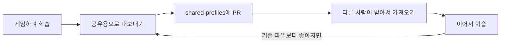

# 학습 데이터 공유

OpenScaler는 게임을 하는 동안 프레임 생성 결과를 스스로 채점하며 그 게임에 맞는 설정을 찾습니다 ([게임별 학습](../README.md#게임별-학습)). 이 학습 데이터는 게임마다 파일 하나라서 다른 사람에게 그대로 넘겨줄 수 있습니다.

잘 학습된 데이터를 받으면 처음부터 배우지 않고 그 상태에서 시작합니다. 받은 사람이 계속 쓰면서 더 좋아지면 다시 공유하고, 그 데이터를 또 다른 사람이 이어받습니다. 이 저장소의 [`shared-profiles`](../shared-profiles) 폴더가 그 최신본을 모아 두는 곳입니다.



## 파일에 들어 있는 것

| 들어 있음 | 들어 있지 않음 |
|---|---|
| 게임 이름 (실행 파일 이름), 저장한 OpenScaler 버전, 게임 화면 크기 | 게임 화면, 스크린샷 |
| 보간용과 외삽용 학습값 (각 다섯 개), 채점 횟수, 점수 기록 | 컴퓨터 이름, 사용자 이름, 파일 경로 |
| 화면 지도 (32×18칸마다 움직임의 방향과 빈도), 프레임 생성 영역 | 설정 파일(OpenScaler.ini)의 다른 설정 |

JSON 텍스트 파일이라 메모장으로 열어 볼 수 있습니다. 크기는 30KB 남짓입니다.

## 언제 공유하면 좋은가

설정 창의 **게임별 학습** 구역에 이런 줄이 있습니다.

```
보간: 최근 채점 200회 평균, 기준보다 +2.1 dB
```

- **기준보다 +dB**: 최근 채점 200회에서 OpenScaler가 만든 프레임이 기준보다 평균 몇 dB 좋았는지입니다. 기준은 보간이면 앞뒤 프레임을 단순히 섞은 것, 외삽이면 앞 프레임을 그대로 둔 것(프레임 생성이 없을 때)입니다. 점수 자체는 그때 나온 장면이 쉬우면 높고 어려우면 낮지만, 기준도 같은 장면으로 채점하므로 차이는 장면의 영향을 덜 받습니다. 그래서 다른 사람의 데이터와 비교할 때 이 값을 씁니다.
- **채점 200회**: 1초에 한 번 채점하므로 프레임 생성을 켜고 3~4분 넘게 하면 쌓입니다. 이보다 적으면 "채점이 200회 넘게 쌓이면 공유하기 좋아요"라고 표시됩니다. 적어도 내보낼 수는 있지만, 우연히 쉬운 장면만 채점됐을 수 있습니다.
- 한 가지 장면(메뉴, 결과 화면)만 오래 띄워 둔 데이터보다 실제 플레이를 여러 판 한 데이터가 좋습니다.

## 내보내기

1. 설정 창 **게임별 학습** 구역에서 **게임**을 고릅니다.
2. **공유용으로 내보내기**를 누르고 저장할 곳을 고릅니다. 파일 이름은 `게임 이름.json`으로 정해져 있으니 바꾸지 않는 것이 좋습니다.

확대 중인 게임이면 아직 저장하지 않은 최근 학습까지 담습니다. 명령줄로도 할 수 있습니다.

```bash
OpenScaler.exe --export-profile "DJMAX RESPECT V" "D:\share\DJMAX RESPECT V.json"
```

## 가져오기

1. 저장소의 [`shared-profiles`](../shared-profiles) 폴더에서 게임 파일을 받습니다 (파일을 열고 Download raw file).
2. 설정 창 **게임별 학습** 구역에서 **공유 데이터 가져오기**를 누르고 받은 파일을 고릅니다.

- 파일 안에 적힌 게임 이름으로 `profiles` 폴더에 들어갑니다. 받은 파일의 이름을 바꿨어도 상관없습니다.
- **이미 그 게임의 데이터가 있으면 `profiles\backup` 폴더로 옮겨 둡니다** (`게임 이름_날짜-시각.json`). 받은 데이터가 마음에 들지 않으면 백업 파일을 `profiles`로 옮기고 이름에서 날짜를 지우면 되돌아갑니다.
- 그 게임을 확대하는 중이면 바로 받은 데이터로 바뀝니다. 확대 중이 아니면 다음에 그 게임을 확대할 때부터 씁니다.
- 받은 데이터 위에서 그대로 이어서 학습합니다. 채점 횟수와 점수 기록도 이어집니다.

명령줄:

```bash
OpenScaler.exe --import-profile "D:\download\DJMAX RESPECT V.json"
```

## 저장소에 올리기 (PR)

GitHub 계정이 있으면 누구나 올릴 수 있습니다.

1. 저장소를 Fork 합니다.
2. 내보낸 파일을 `shared-profiles/게임 이름.json`에 넣습니다. 파일 이름은 파일 안의 `name`과 같아야 합니다 (`\ / : * ? " < > |`는 `_`로 바꿈). 내보내기로 만든 이름을 그대로 쓰면 됩니다.
3. 아래 명령으로 요약을 보고, 그 결과를 PR 본문에 붙입니다.

   ```bash
   python -I tools/profile_info.py "shared-profiles/DJMAX RESPECT V.json"
   ```

4. PR 본문에 함께 적어 주세요.
   - 게임 버전과 실행한 곳 (예: Steam), 게임 창 크기
   - 프레임 생성 방식 (블록 매칭 보간 / 외삽)과 프레임 생성 영역을 지정했는지
   - 대략 어떤 장면을 몇 분 했는지, 체감이 어땠는지

PR을 열면 GitHub Actions가 `shared-profiles` 안의 파일 형식을 검사합니다 (`python -I tools/profile_info.py --check shared-profiles`).

### 이미 있는 파일을 바꿀 때

받은 데이터로 이어서 학습했더니 더 좋아졌다면, 같은 파일을 덮어써서 PR을 엽니다. 두 파일을 나란히 비교하는 결과를 붙여 주세요.

```bash
python -I tools/profile_info.py "기존.json" "새 파일.json"
```

**바꾸는 기준**: 같은 방식(보간 또는 외삽)의 "최근 채점 200회 평균, 기준보다 +dB"가 기존 파일보다 **0.2dB 넘게 높으면** 바꿉니다. 학습이 후보를 채택하는 기준(0.05dB)보다 넉넉하게 잡아, 장면 운으로 생긴 차이로 좋은 데이터가 밀려나지 않게 했습니다. 보간과 외삽 중 하나만 좋아지고 다른 하나가 0.2dB 넘게 나빠졌다면 PR에 그 사실을 적고, 어느 쪽을 쓰는 사람이 많은지로 정합니다.

## 주의할 점

- **게임 이름은 실행 파일 이름입니다.** 같은 게임이라도 배포처에 따라 실행 파일 이름이 다르면 다른 게임으로 저장됩니다. 그럴 때는 `profiles` 폴더의 파일 이름과 파일 안의 `name`을 자기 실행 파일 이름에 맞게 고치면 됩니다.
- **게임 화면 크기**: 학습값 중 칸 크기는 게임 화면의 픽셀 단위라, 공유한 사람과 창 크기가 많이 다르면 최적값이 다를 수 있습니다. 이어서 학습하면서 다시 맞춰집니다. 화면 지도와 프레임 생성 영역은 화면 비율로 저장하므로 창 크기와 상관없이 같은 자리를 가리킵니다.
- **프레임 생성 영역도 함께 옮겨집니다.** 영역을 바꾸면 화면 지도는 처음부터 다시 쌓입니다.
- **RIFE는 학습되지 않습니다.** RIFE 보간만 썼다면 학습값은 기본값 그대로이고, 화면 지도만 쌓여 있습니다.
- 공유받은 파일은 숫자만 담긴 텍스트이고 프로그램이 정해진 후보 안의 값만 받아들이므로, 이상한 값이 들어 있어도 가장 가까운 후보 값으로 바뀔 뿐 실행에 영향을 주지 않습니다.
